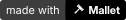

# Mallet branding

Everything here is drawn by the scripts in this folder, so the icon, logos, banners and
social images always match. Change a script and run it again rather than editing an image by
hand.

## The mark

<p>
  
  &nbsp;
  
</p>

Mallet's icon is a white wooden mallet, tilted so its head points to the top right, on a black
circle. Its name is set in Inter Bold. Behind the logo on banners and social images sits a
Hammer-style 2D grid with a dashed selection box and eight resize handles, as if the logo
were a brush selected in one of Hammer's views.

## Colours

| Use | Colour |
| --- | --- |
| Icon circle | `#000000` |
| Mallet glyph and name on dark | `#ffffff` |
| Name on light | `#000000` |
| Tagline on dark | `#8e8e8e` |
| Tagline on light | `#5c5c5c` |
| Grid background | `#0e0e0e` |
| Minor grid lines | `#1e1e1e` |
| Major grid lines, every fourth | `#2f2f2f` |
| Selection box | `#6a6a6a` |
| Selection handles | `#e8e8e8` |

Mallet's brand is black and white on purpose. Leave colour to the maps people make with it.

## Type

- The name: [Inter](https://rsms.me/inter/) Bold at its display optical size, with letters
  2% of an em tighter than normal.
- The tagline: Inter Regular. It reads "A Hammer-style level editor for Source engine maps".

The SVGs have their text turned into outlines, so they look the same on machines without
Inter.

## Using the logo

- Keep clear space around the logo of at least an eighth of the icon's width. The logo files
  already include it.
- Use the `on-dark` logos on dark backgrounds and the `on-light` logos on light ones. The
  icon stays a black circle in both.
- On a dark background where the black circle would vanish, use the inverted icon instead.
- Don't recolour, stretch, rotate, outline or add shadows to the icon or the name, and don't
  set the name in another typeface.

## Files

| Folder | What is in it |
| --- | --- |
| [`./`](.) | The icon as an SVG, PNGs from 32 to 1024 pixels and a Windows `.ico`, plus the bare glyph in `currentColor` (`mallet-glyph.svg`). |
| [`logos/`](logos) | The icon with the name beside it, with and without the tagline, the icon with the name below it, with and without the tagline, and the name alone. Each comes for dark and for light backgrounds, on a transparent background. |
| [`icons/`](icons) | The inverted icon (black mallet on white), rounded-square app icons in both colourways, and the bare glyph in white and in black, all at 1024 pixels. |
| [`banners/`](banners) | Banners at 16:9, 21:9, 2:1, 5:2, 17:6, 3:1 and 4:1. |
| [`social/`](social) | A 1024-pixel profile picture, a 1200 by 630 Open Graph image, a 1080 by 1920 story image, desktop wallpapers at 1440p and 4K, and a phone wallpaper. |
| [`badges/`](badges) | A "made with Mallet" badge for READMEs and Workshop pages, and an 88 by 31 web button at 1, 2 and 4 times its size. |

Every image comes as an SVG and a PNG.

### Which banner where

| File | Fits |
| --- | --- |
| `mallet-banner-16x9` | Videos, Discord server banners and invite backgrounds |
| `mallet-banner-21x9` | Ultrawide headers |
| `mallet-banner-2x1` | The GitHub social preview |
| `mallet-banner-5x2` | Twitch profile banners |
| `mallet-banner-17x6` | Discord profile banners |
| `mallet-banner-3x1` | X headers |
| `mallet-banner-4x1` | LinkedIn and forum headers |
| `social/mallet-og-image` | Link previews on websites |
| `social/mallet-avatar` | Profile pictures and Discord server icons, which are cropped to a circle |

### Showing that a map was made with Mallet

```markdown
[](https://github.com/riggs9162/mallet)
```

## Making the images again

```bash
python branding/make_icons.py
python branding/make_banners.py
python branding/make_assets.py
```

`make_icons.py` needs Pillow. The other two also need fontTools, matplotlib, numpy and the
Inter variable font. If Inter is installed somewhere the scripts don't look, set
`MALLET_BANNER_FONT` to its `.ttf` file.
